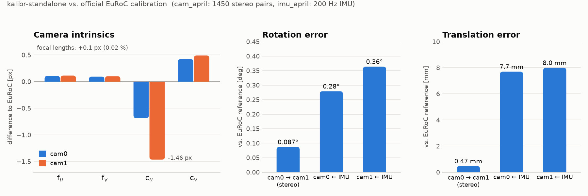

# kalibr-standalone

[](LICENSE) [](https://github.com/rafal7466/kalibr-standalone/releases/latest)  

**[Kalibr](https://github.com/ethz-asl/kalibr) camera and camera–IMU calibration as a standalone C++ toolkit — no ROS, no Python, no Ubuntu.**

Kalibr is the de-facto standard for multi-camera and visual-inertial calibration, but it ships as a ROS/catkin package with a Python front-end, which in practice means an Ubuntu machine (or Docker) with a matching ROS distribution — and ROS 1, which Kalibr depends on, reached end-of-life in May 2025. This repository ports the Python front-end of the two main tools to C++ and builds Kalibr's C++ core libraries with plain CMake, so the whole pipeline runs as native executables — tested on **Windows 10/11 with MSYS2 (UCRT64, GCC)**.

| Original Kalibr tool | This repo | What it estimates |
|---|---|---|
| `kalibr_calibrate_cameras` (Python) | `kalibr_calibrate_cameras.exe` | Intrinsics + distortion of every camera, extrinsics between cameras |
| `kalibr_calibrate_imu_camera` (Python) | `kalibr_calibrate_imu_camera.exe` | Camera–IMU rotation, translation and time offset |
| – | `kalibr_compare_euroc.exe` | Error report of a calibration against the official EuRoC calibration |

Headline result on the EuRoC calibration sequences: focal lengths within **0.1 px (0.02 %)** of the official EuRoC calibration, stereo baseline within **0.47 mm / 0.09°**, reprojection error **≈ 0.3 px**. Full numbers are [below](#results-on-euroc).

<picture>
  <source media="(prefers-color-scheme: dark)" srcset="docs/images/accuracy_vs_euroc_dark.png">
  
</picture>

### Download and run (no build needed)

Prebuilt Windows x64 binaries are attached to every [release](https://github.com/rafal7466/kalibr-standalone/releases/latest): download `kalibr-standalone-<version>-win64.zip`, extract it, put the data in `dataset/` (see [Dataset](#dataset)) and run the PowerShell scripts from the [Usage](#usage) section. All required DLLs are included — no MSYS2, ROS or Python installation is needed.

---

## Contents

- [Download and run (no build needed)](#download-and-run-no-build-needed)
- [Repository layout](#repository-layout)
- [Dependencies](#dependencies)
- [Build](#build)
- [Dataset](#dataset)
- [Usage](#usage)
- [Results on EuRoC](#results-on-euroc)
- [Differences from the original Kalibr](#differences-from-the-original-kalibr)
- [Acknowledgements and license](#acknowledgements-and-license)

## Repository layout

```
kalibr-standalone/
├── kalibr_cpp/                 # new code: CMake build (no catkin) + C++ front-end
│   ├── CMakeLists.txt
│   ├── apps/
│   │   ├── kalibr_calibrate_cameras.cpp
│   │   ├── kalibr_calibrate_imu_camera.cpp
│   │   ├── kalibr_compare_euroc.cpp
│   │   └── common/             # ports of CameraCalibrator, MulticamGraph, ObsDb,
│   │                           # IccCalibrator, IccSensors, dataset readers, writers…
│   ├── cmake/                  # FindSuiteSparse, compatibility patches
│   └── compat/                 # small shims for OpenCV 5 / Boost / MinGW
├── kalibr-master/              # upstream Kalibr sources (ethz-asl/kalibr, unmodified in git)
├── scripts/
│   ├── setup_msys2.sh          # installs all build dependencies with pacman
│   ├── build.sh                # configures + builds kalibr_cpp
│   ├── run_cam_calib.ps1       # camera calibration on an EuRoC sequence
│   ├── run_imu_calib.ps1       # camera-IMU calibration on an EuRoC sequence
│   └── compare_euroc.ps1       # comparison with the EuRoC reference
├── docs/images/               # README figures (scripts/make_readme_figure.py)
├── reference/                  # official EuRoC calibration (cam0/cam1 sensor.yaml)
└── results/                    # outputs of all runs + comparison reports (report_*.md)
```

`dataset/` (EuRoC data) and `tools/msys64/` (an optional private MSYS2) are created locally and are not part of the repository.

## Dependencies

All dependencies come from MSYS2's **UCRT64** environment:

| Package (`mingw-w64-ucrt-x86_64-…`) | Used for | Version tested |
|---|---|---|
| `gcc` | C++17 compiler | 16.2 |
| `cmake`, `ninja` | build system | CMake 4.4 (≥ 3.16 required), Ninja 1.13 |
| `boost` | system, serialization, filesystem, thread, regex | 1.92 (≥ 1.73) |
| `eigen3` | linear algebra | 5.0 (3.4 also fine) |
| `suitesparse` | CHOLMOD / SPQR sparse solvers | 7.14 |
| `openblas` | BLAS/LAPACK for SuiteSparse | 0.3.34 |
| `opencv` | image I/O, corner refinement | 5.0 (4.x also supported) |
| `yaml-cpp` | reading/writing Kalibr YAML files | 0.9 |
| `qt6-base` | runtime dependency of OpenCV's `highgui` module (used by Kalibr's target detectors) | 6.x |

Not needed: ROS, catkin, Python, NumPy, wxPython, Docker, WSL or Ubuntu.

### Install MSYS2 and the dependencies

1. Install MSYS2 from <https://www.msys2.org> (default location `C:\msys64`).  
   *Alternatively* extract the MSYS2 base archive into `tools\msys64` inside this repository to keep a private toolchain that does not touch any system MSYS2 — the scripts look in `tools\msys64` first, then `C:\msys64` (or set `MSYS2_ROOT`).
2. Open the **MSYS2 UCRT64** shell and run:

```bash
pacman -Syuu        # run twice if the first run asks to restart the shell
pacman -S --needed \
  mingw-w64-ucrt-x86_64-gcc   mingw-w64-ucrt-x86_64-cmake  mingw-w64-ucrt-x86_64-ninja \
  mingw-w64-ucrt-x86_64-boost mingw-w64-ucrt-x86_64-eigen3 mingw-w64-ucrt-x86_64-suitesparse \
  mingw-w64-ucrt-x86_64-opencv mingw-w64-ucrt-x86_64-yaml-cpp mingw-w64-ucrt-x86_64-openblas \
  mingw-w64-ucrt-x86_64-qt6-base
```

(`scripts/setup_msys2.sh` does exactly this, non-interactively.) The download is about 0.5 GB (≈ 3 GB installed). If a mirror is slow or returns an error, pacman switches to another mirror automatically; if the command still stops with a download error, simply run it again.

> **Do not skip `qt6-base`.** MSYS2's OpenCV is built with Qt; without it the build still succeeds, but the bundling step stops with an error listing the missing `Qt6*.dll` files (before this check existed, the executables simply refused to start).

## Build

In the MSYS2 UCRT64 shell, from the repository root:

```bash
./scripts/build.sh
```

or manually:

```bash
cd kalibr_cpp
cmake -S . -B build -G Ninja -DCMAKE_BUILD_TYPE=Release   # KALIBR_SRC_DIR defaults to ../kalibr-master
cmake --build build -j
```

The build produces `kalibr_cpp/build/kalibr_calibrate_cameras.exe`, `kalibr_calibrate_imu_camera.exe` and `kalibr_compare_euroc.exe` (log in `kalibr_cpp/build.log`).

At configure time `cmake/KalibrPatches.cmake` applies a few small, idempotent source fixes to `kalibr-master` that are only needed for current dependency versions (SuiteSparse 7, Boost ≥ 1.73, OpenCV 5, MinGW's 32-bit `long`, missing `random()`). They do not change any algorithm.

After linking, a post-build step copies all required runtime DLLs (GCC runtime, Boost, OpenCV, SuiteSparse, …) next to the executables, so `kalibr_cpp/build/` is self-contained: the tools run from PowerShell, cmd or any MSYS2 shell, independent of what is on `PATH`, and the folder can be copied to another Windows PC. Disable this with `-DKALIBR_BUNDLE_DLLS=OFF`.

The CMake project is plain CMake and should also build on Linux/macOS with the same dependencies installed from the system package manager (e.g. `libboost-all-dev libeigen3-dev libsuitesparse-dev libopencv-dev libyaml-cpp-dev`); only the Windows/MSYS2 path has been tested.

## Dataset

The tools read the **EuRoC / ASL folder format** instead of rosbags:

```
<sequence>/mav0/
├── cam0/data.csv, cam0/data/<timestamp>.png, cam0/sensor.yaml
├── cam1/...
└── imu0/data.csv, imu0/sensor.yaml
```

The results in this repository were produced with the EuRoC **calibration datasets** (`cam_april`, `imu_april`, `cam_checkerboard`). All EuRoC files are hosted on the ETH Research Collection ([doi:10.3929/ethz-b-000690084](https://doi.org/10.3929/ethz-b-000690084), linked from the [EuRoC MAV dataset page](https://projects.asl.ethz.ch/datasets/euroc-mav/)): download **"Calibration Datasets" (ZIP, ≈ 4.2 GB)**, extract it into `dataset/`, and extract any per-sequence `.zip` files it contains in place, so that you get:

```
dataset/calibration_datasets/cam_april/{april_6x6.yaml, mav0/}
dataset/calibration_datasets/imu_april/{april_6x6.yaml, mav0/}
dataset/calibration_datasets/cam_checkerboard/{checkerboard_7x6.yaml, mav0/}
```

Any other sensor setup can be used as long as it is stored in this format (one folder per camera with `data.csv` + images, and an IMU `data.csv`).

## Usage

### Quick start (PowerShell, EuRoC)

```powershell
# 1) camera intrinsics + stereo extrinsics  (~5 min on all 1450 image pairs; -Freq 4 → ~1 min)
powershell -ExecutionPolicy Bypass -File scripts\run_cam_calib.ps1 -Seq cam_april -Name cam_april

# 2) camera-IMU spatial + temporal calibration  (~1.5 min)
powershell -ExecutionPolicy Bypass -File scripts\run_imu_calib.ps1 -CamChain results\cam_april\cam_april-camchain.yaml -Name imu_april

# 3) compare with the official EuRoC calibration
powershell -ExecutionPolicy Bypass -File scripts\compare_euroc.ps1 `
    -CamChain results\cam_april\cam_april-camchain.yaml `
    -ImuCam   results\imu_april\imu_april-camchain-imucam.yaml `
    -Report   results\report.md
```

Each run writes `results/<name>/log.txt` with the full console output and the runtime.

### Direct command line

The options mirror the original Python tools (`--models`, `--target`, `--bag-from-to`, `--bag-freq`, `--approx-sync`, `--mi-tol`, `--no-shuffle`, `--max-iter`, `--recover-covariance`, `--no-time-calibration`, `--reprojection-sigma`, …). The only difference is the input: `--bag/--topics <ros topics>` is replaced by `--dataset <mav0 folder> --topics <camera sub-folders>`. Run any tool with `--help` for the full list.

```bash
kalibr_calibrate_cameras \
    --target  cam_april/april_6x6.yaml \
    --dataset cam_april/mav0 --topics cam0 cam1 \
    --models  pinhole-radtan pinhole-radtan \
    --output  out/cam_april

kalibr_calibrate_imu_camera \
    --target  imu_april/april_6x6.yaml \
    --dataset imu_april/mav0 \
    --cams    out/cam_april-camchain.yaml \
    --imu     imu_april/mav0/imu0/sensor.yaml \
    --output  out/imu_april
```

Output files use the same names and format as Kalibr, so they can be fed directly to VIO/SLAM systems that consume Kalibr results (OpenVINS, VINS-Fusion, ORB-SLAM3, Basalt, …):

| File | Content |
|---|---|
| `<out>-camchain.yaml` | camera models, intrinsics, distortion, `T_cn_cnm1` |
| `<out>-results-cam.txt` | human-readable camera calibration summary with standard deviations |
| `<out>-reprojection-errors.csv` | per-corner reprojection errors |
| `<out>-camchain-imucam.yaml` | camchain + `T_cam_imu` and `timeshift_cam_imu` |
| `<out>-imu.yaml` | IMU noise model used |
| `<out>-results-imucam.txt` | residual statistics and estimated transformations |

## Results on EuRoC

All runs below are stored in [`results/`](results/) (YAML outputs, logs, per-corner errors) together with the generated comparison reports. The reference is the official EuRoC calibration in [`reference/`](reference/).

### Camera intrinsics — `cam_april`, all 1450 stereo pairs ([report](results/report_cam_april__imu_april.md))

| | f<sub>u</sub> | f<sub>v</sub> | c<sub>u</sub> | c<sub>v</sub> | k<sub>1</sub> | k<sub>2</sub> |
|---|---|---|---|---|---|---|
| cam0 kalibr-standalone | 458.761 | 457.389 | 366.530 | 248.799 | −0.2861 | 0.0764 |
| cam0 EuRoC reference   | 458.654 | 457.296 | 367.215 | 248.375 | −0.2834 | 0.0740 |
| cam1 kalibr-standalone | 457.700 | 456.235 | 378.535 | 255.729 | −0.2862 | 0.0768 |
| cam1 EuRoC reference   | 457.587 | 456.134 | 379.999 | 255.238 | −0.2837 | 0.0745 |

- Focal length difference ≈ 0.1 px (0.02 %); principal point 0.4 – 1.5 px.
- Reprojection error (1σ): cam0 [0.31, 0.25] px, cam1 [0.30, 0.25] px.

### Stereo extrinsics cam0 → cam1

| Run | Rotation error | Translation error | Baseline (ours / EuRoC) |
|---|---|---|---|
| `cam_april` (all frames) | 0.087° | 0.47 mm | 109.90 / 110.08 mm |
| `cam_checkerboard` (4 Hz) | 0.046° | 1.41 mm | 109.52 / 110.08 mm |

### Camera–IMU extrinsics and time offset — `imu_april`

| Camera | Rotation error | Translation error | Estimated time offset |
|---|---|---|---|
| cam0 | 0.28° | 7.7 mm | 0.010 ms |
| cam1 | 0.36° | 8.0 mm | 0.013 ms |

Residuals: reprojection 0.44 px (mean), gyroscope 0.0026 rad/s, accelerometer 0.040 m/s² — the normalized residuals are ≈ 1, i.e. at the level of the sensor noise model.

**Repeatability.** Re-running with the IMU calibration at 10 Hz instead of 20 Hz changes the translation by only ≈ 0.4 mm (rotation by < 0.01°), comparable to the ≈ 0.25 mm repeatability reported for the original Kalibr. The ≈ 8 mm offset to the EuRoC `T_BS` is therefore systematic (the reference was produced with a different Kalibr version / settings, e.g. IMU noise parameters), not run-to-run noise. Two independent full runs (`*_run2`) reproduce the results bit-for-bit thanks to the deterministic view ordering (`--seed`).

### Checkerboard target

`cam_checkerboard` at 4 Hz reaches 0.15 px reprojection error and a good baseline, but its intrinsics deviate from the reference by ≈ 0.8 % (f<sub>u</sub>) and ≈ 6 px (c<sub>u</sub>): the checkerboard must be fully visible to be detected, so the image borders are poorly covered, and the EuRoC reference was computed with the AprilGrid. Prefer an AprilGrid target.

### Runtime (Windows, Release build)

| Run | Data | Runtime |
|---|---|---|
| `cam_april` | 2 × 1450 images | 290 s |
| `cam_april_4hz` | 4 Hz subsample | 65 s |
| `cam_checkerboard` | 4 Hz | 32 s |
| `imu_april` | 20 Hz images + 200 Hz IMU | 84 s |
| `imu_april_10hz` | 10 Hz images | 43 s |

### All result folders

| Folder | Description | Report |
|---|---|---|
| `cam_april`, `cam_april_run2` | AprilGrid, all frames (two identical runs) | [report](results/report_cam_april__imu_april.md), [run 2](results/report_run2.md) |
| `cam_april_4hz` | AprilGrid, 4 Hz | [report](results/report_cam_april_4hz.md) |
| `cam_checkerboard` | checkerboard, 4 Hz | [report](results/report_cam_checkerboard.md) |
| `imu_april`, `imu_april_run2` | camera–IMU, default settings | [report](results/report_cam_april__imu_april.md) |
| `imu_april_10hz` | camera–IMU, images at 10 Hz | [report](results/report_imu_april_10hz.md) |
| `imu_april_cov` | camera–IMU with `--recover-covariance` | [report](results/report_imu_april_cov.md) |
| `imu_april_test` | camera–IMU test run | [report](results/report_imu_april_test.md) |

## Differences from the original Kalibr

- The Python front-end (`CameraCalibrator`, `MulticamGraph`, `ObsDb`, `IccCalibrator`, `IccSensors`, dataset readers, result writers) is rewritten in C++. Kalibr's C++ libraries (Schweizer-Messer, aslam_cv, aslam_optimizer, aslam_nonparametric_estimation, incremental_calibration, ethz_apriltag2) are used without algorithmic changes.
- Input is an ASL/EuRoC folder instead of a rosbag. Output files follow Kalibr's formats.
- Not implemented: the PDF report and plots, `kalibr_calibrate_rs_cameras` (rolling shutter), multiple IMUs and the `scale-misalignment` IMU models — only the `calibrated` IMU model with a single IMU is supported.
- `--recover-covariance` crashes in the original Kalibr because of `BSplineMotionError`; here it runs but standard deviations of the camera–IMU extrinsics are not reported.
- The order in which views are processed is randomized with a fixed `--seed` (default 0), making runs reproducible.

## Acknowledgements and license

This repository is released under the [BSD 3-Clause license](LICENSE); attribution of the upstream Kalibr code it is derived from is in [NOTICE](NOTICE). To cite it, use GitHub's *Cite this repository* button (generated from [`CITATION.cff`](CITATION.cff)) and please also cite the original Kalibr papers listed below.

This work builds directly on **Kalibr** by the Autonomous Systems Lab, ETH Zurich ([ethz-asl/kalibr](https://github.com/ethz-asl/kalibr)), distributed under the BSD 3-Clause license; the upstream sources and their license are kept in [`kalibr-master/`](kalibr-master/LICENSE). If you use this code in academic work, please cite the original Kalibr papers:

- P. Furgale, J. Rehder, R. Siegwart, “Unified Temporal and Spatial Calibration for Multi-Sensor Systems,” IROS 2013.
- P. Furgale, T. D. Barfoot, G. Sibley, “Continuous-Time Batch Estimation Using Temporal Basis Functions,” ICRA 2012.
- J. Maye, P. Furgale, R. Siegwart, “Self-supervised Calibration for Robotic Systems,” IEEE IV 2013.
- J. Rehder, J. Nikolic, T. Schneider, T. Hinzmann, R. Siegwart, “Extending kalibr: Calibrating the extrinsics of multiple IMUs and of individual axes,” ICRA 2016.

EuRoC data: M. Burri et al., “The EuRoC micro aerial vehicle datasets,” IJRR 2016.

Author of the standalone C++ port: **Mohammadreza** ([@rafal7466](https://github.com/rafal7466)), Sharif University of Technology.
